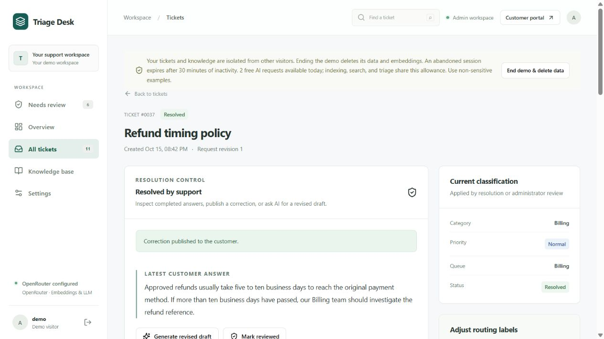
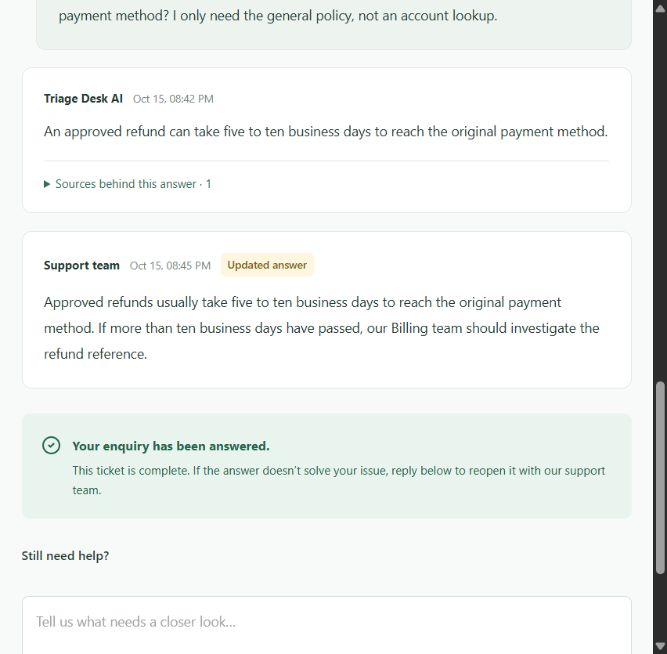
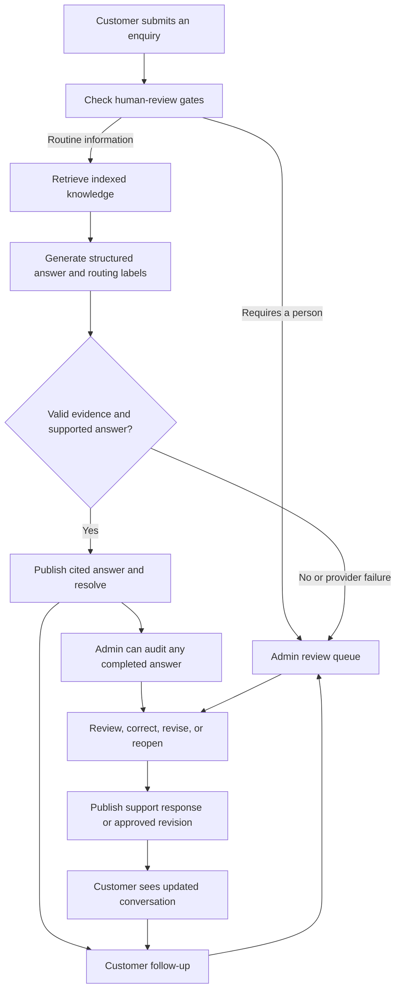

# Triage Desk

### AI support that answers routine questions and brings people in when needed.

A full-stack support application with a customer enquiry portal and an administrator workspace. It retrieves approved knowledge, writes answers with cited sources, and sends sensitive or unsupported requests to a human. Completed answers remain reviewable and correctable.

**[Open the live demo](https://ai-ticket-triage-chi.vercel.app/)** · **[Customer portal](https://ai-ticket-triage-chi.vercel.app/support)** · **[Deployment health](https://ai-ticket-triage-chi.vercel.app/api/health)**

[Try both roles yourself](#try-both-roles-yourself) · [Run locally](#run-locally) · [Tech stack](#tech-stack) · [Engineering guide](docs/engineering.md)

## The idea

Support teams repeatedly answer the same policy and how-to questions while account problems, security incidents, and exceptions need individual attention. A useful AI assistant should reduce repetitive work while leaving the team in control of customer outcomes.

Triage Desk turns a maintained knowledge base into a first line of support. A customer asks a question; the application retrieves relevant passages and uses a language model to produce a structured answer, category, priority, and queue. The server validates the evidence before publishing. Routine, supported enquiries finish automatically; requests requiring judgment or action enter **Needs review**.

The project goes beyond classification: an administrator can inspect an answer after completion, publish a correction, request a private AI revision, or reopen the ticket. The customer sees the conversation history, including updates, and can ask for more help.

## See it in action

**Administrator workspace — reviewing a completed ticket and publishing a correction**



<details>
<summary><strong>Customer view — original answer, support correction, and follow-up</strong></summary>

<br>


</details>

These screenshots show the deployed app using fictional test enquiries. Demo tickets are temporary, so ticket numbers will differ in a new session.

## What it does

- **Customer portal:** submit enquiries, read cited answers, revisit recent tickets, and reply to reopen an issue.
- **Automatic answers:** retrieve indexed articles and publish grounded responses to routine informational questions.
- **Human review:** escalate financial actions, identity recovery, security incidents, outages, explicit human requests, and requests without adequate evidence.
- **Administrator controls:** audit completed answers, publish corrections, generate private revisions, adjust routing labels, and inspect the change history.
- **Knowledge management:** maintain support articles and a separate urgency policy, rebuild the embedding index, and inspect retrieved passages.
- **Isolated public demos:** each visitor receives a temporary workspace with six labelled example articles and three example tickets.
- **Controlled AI usage:** shared database counters limit requests; configured models must use `:free` endpoints, with no paid model fallback.
- **Triage comparison:** compare AI recommendations with a deterministic rules baseline and record manual classification decisions.

## Try both roles yourself

You can be the ticket raiser and the administrator. Use **two tabs in the same browser profile** so they share your isolated demo workspace. Separate browsers or private windows create different sessions.

### 1. Start as the administrator

1. Open the [live administrator workspace](https://ai-ticket-triage-chi.vercel.app/).
2. Click **Try the demo**. The public demo credentials are `demo` / `try-triage`; no owner credentials are needed.
3. Open **Knowledge base**. The demo includes fictional support guidance and an urgency policy. If an empty demo offers **Load starter examples**, click it first.
4. Click **Rebuild index** and wait for it to finish. This prepares the articles for retrieval and consumes an embedding request.
5. Keep the admin tab open. Open **Customer portal** in a second tab in the same browser.

### 2. Raise an enquiry as the customer

1. In the [customer portal](https://ai-ticket-triage-chi.vercel.app/support), select **New enquiry**.
2. Enter a subject and one of the enquiries below, then click **Get help**.
3. Note the ticket number so you can find it in the admin tab.
4. For an automatic answer, expand **Sources behind this answer** to inspect its evidence. A review case displays **With support**.

**Expected automatic answer — general refund policy**

> After a refund has been approved, how long does it usually take to reach the original payment method? I only need the general policy, not an account lookup.

With the starter knowledge indexed, the answer should explain the documented five-to-ten-business-day timeframe and cite the Billing article.

**Expected automatic answer — technical reporting guidance**

> What information should I include when reporting a technical problem? I only need the documented checklist, not an investigation of my account.

The answer should give the reporting checklist from the starter guidance.

**Expected admin review — request a financial action**

> Please issue a refund for my most recent subscription payment.

**Expected admin review — account recovery**

> I lost my authenticator and cannot sign in. Please reset two-factor authentication on my account.

**Expected admin review — unsupported information**

> Exactly how many gigabytes of storage are included in the Enterprise plan?

The starter knowledge does not establish a storage allowance, so this should go to support instead of inventing a number. Provider errors, exhausted quotas, or a missing/stale index can also send a routine question to review.

### 3. Handle an enquiry as the administrator

1. Return to the admin tab and open **Needs review**. Refresh the page if a new enquiry has not appeared yet.
2. Open the ticket with the number you noted. Read the escalation explanation and expand **Customer conversation**.
3. In **Correction or revision instructions**, write the complete response you want the customer to receive.
4. Click **Publish correction**. This publishes your response and resolves the ticket as **Resolved by support**.
5. Return to the customer tab, open the same enquiry under **Recent enquiries**, and click **Refresh** to see your response.

The prototype records support replies; it does not execute refunds, reset accounts, or perform external actions. For those requests, explain the next support step rather than claiming an action was completed.

### 4. Review and change an already resolved ticket

1. Open **All tickets** in admin, filter for resolved tickets, and select the refund-policy enquiry from step 2. You can also use **Overview → Audit AI answers**.
2. Inspect the latest answer and the sources in **Customer conversation**. Click **Mark reviewed** to record that you checked an acceptable answer.
3. To change it, paste this complete replacement into **Correction or revision instructions**:

   > Approved refunds usually take five to ten business days to reach the original payment method. If more than ten business days have passed, our Billing team should investigate the refund reference.

4. Click **Publish correction**. Refresh the customer tab: the original answer remains visible, followed by the support team's **Updated answer**.
5. Expand **Audit trail** in admin to inspect the recorded review and correction.

For an AI-assisted edit, enter internal instructions such as “Make the answer shorter and retain the refund timeframe,” then click **Request AI changes**. Inspect the result marked **Draft · not visible to customer**, then click **Publish revised answer**. Revision instructions stay internal; **Publish correction** immediately publishes the text you entered.

To reopen a ticket yourself, enter a reason and click **Reopen for review**. To try the customer route, type under **Still need help?** and click **Send to support team**; the ticket returns to human review.

**Demo lifecycle:** the workspace expires after 30 minutes of inactivity. **End demo & delete data** removes its content; do this after your walkthrough. Keep the session active until you finish testing both roles. Use fictional, non-sensitive enquiries. The app displays the remaining AI allowance, and free-provider availability can vary.

## Tech stack

- **Frontend:** React 19, TypeScript, Vite, React Router, custom CSS, and Lucide icons.
- **Backend:** Python 3.13, FastAPI, Pydantic validation, and Uvicorn.
- **Data layer:** SQLModel / SQLAlchemy and Alembic migrations; SQLite locally, Neon PostgreSQL in the deployment.
- **AI:** OpenRouter for embeddings and JSON-schema structured generation. Defaults are `nvidia/nemotron-3-embed-1b:free` and `nvidia/nemotron-3-super-120b-a12b:free`.
- **Retrieval:** chunked articles, SQL-stored embeddings, bounded cosine-similarity search, and exact-quote evidence validation.
- **Hosting:** Vercel serves the React build and FastAPI API as one project; persistent application data lives in PostgreSQL.
- **Quality checks:** pytest, Vitest, Playwright, and GitHub Actions with a PostgreSQL integration service.

## How an enquiry moves through the app



Embeddings find relevant passages; the language model writes the answer. The server checks output structure, taxonomy values, and quoted evidence. Version checks prevent older AI work from overwriting a newer human decision or publishing against changed knowledge. Public conversation messages and audit events preserve the history.

## Run locally

### 1. Install the prerequisites

- Python **3.13** available as `python`.
- Node.js **22 or 24** with npm.
- Git and an OpenRouter API key for automatic answers and indexing.

The live demo uses a key configured on Vercel. A local clone needs your own key in `.env`; deployment secrets are not included in GitHub. Manual decisions and rules comparison can run without a provider key.

### 2. Clone and configure

```powershell
git clone https://github.com/k4rthiikeyan/ai-ticket-triage.git
cd ai-ticket-triage
Copy-Item .env.example .env
```

Edit `.env` before the first start. Replace the password and key placeholders:

```dotenv
ADMIN_USERNAME=admin
ADMIN_PASSWORD=replace_with_your_own_strong_password
OPENROUTER_API_KEY=replace_with_your_openrouter_key
DATABASE_URL=sqlite:///./data/triage.db
COOKIE_SECURE=false
CUSTOMER_PORTAL_ENABLED=true
PUBLIC_DEMO_ENABLED=true
```

Leave the other settings from `.env.example` in place. `PUBLIC_DEMO_ENABLED=true` enables the temporary demo and starter content; set it to `false` if you only want your persistent owner workspace. Keep real keys and `.env` out of commits.

### 3. Install and start — Windows PowerShell

```powershell
.\scripts\setup.ps1
.\scripts\start.ps1
```

Setup creates `.venv`, installs Python and frontend dependencies, and builds the frontend. Startup applies database migrations and creates the first administrator.

- **Admin:** [http://127.0.0.1:8000/](http://127.0.0.1:8000/)
- **Customer:** [http://127.0.0.1:8000/support](http://127.0.0.1:8000/support)
- **Health check:** [http://127.0.0.1:8000/api/health](http://127.0.0.1:8000/api/health)

Select **Try the demo** and repeat the two-tab walkthrough above, using the local URLs. To keep your own data, sign in as `admin` with your configured password instead, then add knowledge as described below. Press `Ctrl+C` in the terminal to stop the server.

<details>
<summary><strong>macOS / Linux manual setup</strong></summary>

After cloning, from the repository root:

```bash
python3.13 -m venv .venv
source .venv/bin/activate
python -m pip install -r requirements-dev.txt
cp .env.example .env
# Edit .env with your administrator password and OpenRouter key.
npm ci --prefix frontend
npm run build --prefix frontend
python -m uvicorn backend.app.main:app --host 127.0.0.1 --port 8000
```

</details>

For frontend development with hot reload, keep the backend running and run `npm run dev --prefix frontend` in a second terminal. Use the URL Vite prints; it proxies `/api` to port 8000.

### 4. Set up your persistent owner workspace

The owner workspace starts empty. Demo examples are kept separately.

1. Sign in at the local admin URL with the credentials from `.env`.
2. Open **Knowledge base → New article**, enter a title and support guidance, then save. For a minimal example, use title **Billing support** and this content:

   ```text
   Refunds, invoices, receipts, subscription charges and declined payments belong to Billing.
   An approved refund can take five to ten business days to reach the original payment method.
   If ten business days have passed, Billing should investigate the refund reference.
   ```

3. Create another article titled **Urgency policy**, check **Use as urgency policy**, and save this example:

   ```text
   Routine billing enquiries have normal priority.
   A delayed refund has normal priority while the product is working and there is no suspected fraud or account compromise.
   Work-blocking incidents with no workaround have high priority.
   Suspected account compromise or a service outage affecting all users has urgent priority.
   Future optional feature requests have low priority.
   Unrelated, ambiguous or unsupported requests require human review.
   ```

4. Click **Rebuild index**. Rebuild again whenever you edit articles or change the embedding model.
5. Open the local customer portal in a second tab, submit the general refund-policy question, then return to admin to inspect the result.

Admin credentials bootstrap the first account only; changing `.env` later does not change an existing account's password. If `.env.local` exists, it overrides matching `.env` settings.

The admin **New ticket → Run triage → Confirm decision** controls provide a separate classification workflow. To test customer answers and conversation updates, raise the enquiry through **Customer portal**.

## Verification

From the repository root on Windows:

```powershell
.\.venv\Scripts\python.exe -m pytest -q
npm test --prefix frontend
npm run build --prefix frontend
Push-Location frontend
npx playwright install chromium
npm run test:e2e
Pop-Location
```

API and browser tests use isolated databases and mocked OpenRouter transport. They cover automatic completion, escalation, session isolation, evidence checks, private revisions, corrections, follow-ups, and stale-result protection. GitHub Actions also runs against PostgreSQL 16. The local PostgreSQL test is skipped unless a disposable `TEST_POSTGRES_URL` is configured.

The deployed app was also exercised with the real provider on **15 October 2026**: three informational enquiries received automatic answers; five financial, recovery, outage, explicit-human, and unsupported requests went to review. A completed answer was marked reviewed, corrected by an administrator, and verified in the customer conversation. This is a functional smoke test, not an accuracy benchmark.

See the [engineering verification guide](docs/engineering.md#verification) for opt-in local and deployed provider checks. The [evaluation guide](evaluation/README.md) explains the hand-labelled rules benchmark and its limitations; rules results do not measure LLM accuracy.

## Project structure

```text
backend/app/
  routes/              Admin and customer APIs
  services/            Retrieval, resolution, triage, provider, usage, isolation
  models.py            Database entities
  schemas.py           Request and structured-output validation
backend/migrations/    Alembic schema upgrades
frontend/src/          Customer portal and administrator interface
frontend/e2e/          Playwright workflow tests
tests/                 Backend and database integration tests
evaluation/            Fixtures, benchmarks, and opt-in live checks
scripts/               Local setup and release verification
docs/                  Engineering guide and product screenshots
```

## Scope and next steps

This is a portfolio prototype for a small, maintained knowledge base. Retrieval uses a bounded SQL-stored index rather than a dedicated vector service. Customer history is tied to an anonymous browser session, and application-level workspace checks provide isolation. Automatic completion means an informational answer was published; it does not prove customer satisfaction or perform external account actions.

Useful future extensions include verified customer accounts, helpdesk integrations, durable background workers, database-native vector search, and a larger independently labelled evaluation set. These are future work.

For hosting configuration, environment settings, database behavior, request budgets, and deployment steps, read the [engineering and deployment guide](docs/engineering.md). The [redesign plan](REDESIGN_PLAN.md) documents the product decisions and release evidence.
